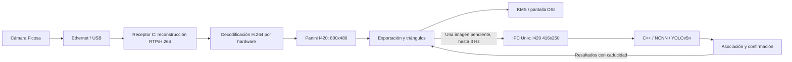

# Sistema, requisitos y diseño

Fecha de corte: 24/10/2026. Véanse el [resumen](README.md) y el [índice de evidencias](05-evidencias.md).

## Objetivo y alcance

Retrovisor digital para un coche de carreras: al recibir alimentación, la Raspberry debe arrancar y mostrar automáticamente la cámara orientada hacia atrás. El funcionamiento normal no debe depender de un PC, Wi-Fi ni Internet. Los vehículos de interés son los que siguen o adelantan al coche; la carrocería propia y vehículos de servicio/aparcados pueden constituir falsas alarmas operativas aunque sean vehículos reales.

La pantalla debe mostrar la imagen y, cuando exista una detección confirmada, un triángulo sobre el vehículo. Las cajas se usan internamente; no se exige dibujarlas ni cubrir las ruedas. Tras estabilizar esta base se implementarán colores según distancia, con estimación y umbrales validados.

## Hardware e interfaces

| Componente | Identificación y límites conocidos |
|---|---|
| Raspberry | Pi 3 Model A+, cuatro núcleos, sistema ARMv7 de 32 bits; aproximadamente 424–425 MiB visibles para Linux |
| Sistema operativo observado | Raspbian GNU/Linux 13, Trixie |
| Pantalla | IPS táctil DSI, 7 pulgadas, 800×480; marca/modelo exactos del ejemplar sin confirmar |
| Cámara | Ficosa, lente fisheye; vídeo H.264 1344×968, aproximadamente 25 fps; calibración y referencia exacta pendientes |
| Enlace de cámara | Adaptador RJ45 y USB Ethernet ASIX AX88772B; interfaz `eth0` en la Pi |
| Medio de arranque | microSD de 64 GB según información del usuario |
| Radar | No disponible; presupuesto futuro indicado de hasta 300 €, sin selección validada |
| Integración mecánica y alimentación del coche | No validadas |

La disposición de placa de la pantalla se comparó con un manual de una familia similar. Las dimensiones y anclajes de ese manual **no prueban identidad de modelo ni compatibilidad de una carcasa**. Referencias: [pantalla](../documentation_pantalla/referencias.md) y [manual](../documentation_pantalla/7inch-DSI-Display-manual.pdf).

## Arquitectura ejecutada



El receptor es específico de la encapsulación observada: VLAN 2, IPv6 multicast `ff14::2:d`, UDP 42800 y RTP payload type 127. Agrupa por timestamp RTP y reconstruye datos Annex B SPS/PPS/IDR. El filtro de MAC y el tratamiento de las imágenes IDR corresponden a esta cámara; no se afirma compatibilidad universal RTP. Código: [receptor](../src/rear_camera.c) y [ensamblador](../src/camera_rtp.c).

Las colas de vídeo son cortas y descartan material antiguo. Se rechazan imágenes en directo que superan 150 ms de edad local en los puntos implementados. El watchdog de vídeo usa 3 s y systemd reinicia el proceso ante fallos. Esto limita la presentación de imágenes antiguas, pero puede reducir fps bajo sobrecarga. No demuestra latencia física cámara-pantalla inferior a 150 ms.

## Geometría Panini

Se aplica mapeo inverso: píxel de salida → inversa de Panini → rayo 3D → orientación → lente equidistante supuesta → imagen de entrada. El mapa se precalcula y se muestrea mediante interpolación bilineal en I420. Las zonas no válidas quedan negras.

Perfil activo: `d=1`, FOV de lente supuesto 180°, FOV de salida 130°, pitch 0° y salida 800×480. La elección del FOV fue visual. La formulación completa, sus referencias y los límites están en [calibration/panini.md](../calibration/panini.md); implementación en [panini.c](../src/panini.c) y [gst_panini.c](../src/gst_panini.c).

No se dispone de matriz K, coeficientes y modelo real de lente validados. Panini no equivale a una calibración métrica ni valida una estimación de distancia.

## Detector, seguimiento y dibujo

- Pesos YOLOv5n v7.0; NCNN en CPU, sin entrenamiento ni cuantización añadidos. Se conserva la procedencia del ONNX y se convierten sus tres cabezas para el adaptador nativo.
- Entrada IPC I420 416×250. Conversión de color según metadatos BT.601/709 y rango; RGB/255 y letterboxing rectangular alineado a 32: **320×192** para esa entrada. Se elimina relleno respecto al cuadrado 320×320, sin reducir el tamaño de la escena ya escalada. Sigue existiendo menos detalle que en los ensayos PC a 640.
- Umbral de observación 0,15; una pista debe alcanzar 0,25 al menos una vez y tener dos observaciones asociadas para publicarse. Categorías COCO: coche, moto, bus y camión. Bus/camión/coche comparten asociación para reducir cambios de etiqueta.
- NMS de vehículos con IoU 0,45; asociación propia por solapamiento, no ByteTrack. Máximo 16 detecciones por resultado.
- Solo una imagen pendiente de respuesta; tope de exportación 3 Hz y reintento acotado si falta el trabajador. El vídeo no espera su respuesta.
- Entradas del detector con más de 300 ms se rechazan. Resultados y pistas caducan a los 750 ms desde su timestamp local original; una observación vacía no prolonga esa edad.
- El triángulo blanco con contorno negro se sitúa sobre el centro horizontal del borde superior del vehículo. Se permite predicción lineal hasta 500 ms y hasta media caja; no es predicción de colisión.

Fuentes: [YOLO](../src/yolov5.hpp), [trabajador](../src/vehicle_detector.cpp), [protocolo](../src/vehicle_protocol.h), [seguimiento](../src/vehicle_tracking.c) y [dibujo](../src/gst_vehicles.c). El timestamp `captured_ns` deriva de la cronología local del vídeo; no procede de un disparo físico de exposición de la cámara.

## Servicios y configuración observada

`rear-camera` ejecuta [run-pi.sh](../run-pi.sh), con capacidades de captura de red y acceso al dispositivo de vídeo. La consola dedicada `tty7` evita mostrar texto detrás de las bandas; [display-console.sh](../display-console.sh) prepara el fondo y muestra `SIN VIDEO` cuando no hay plano de vídeo activo.

El trabajador tiene reinicio independiente, prioridad reducida y espacio de ejecución Unix privado. El vídeo usa núcleos 0–1 y el detector 2–3. NCNN usa espera OpenMP pasiva. Véanse las [unidades de vídeo](../systemd/rear-camera.service) y [detector](../systemd/rear-camera-detector.service).

```ini
CAMERA_PANINI=1
CAMERA_COMPRESSION=1
CAMERA_LENS_FOV=180
CAMERA_VIEW_FOV=130
CAMERA_PITCH=0
CAMERA_DETECTION=1
CAMERA_DETECTOR_MODEL=yolov5n
CAMERA_DETECTOR_SIZE=320
CAMERA_DETECTOR_RECT=1
CAMERA_DETECTOR_THREADS=2
CAMERA_DETECTOR_THRESHOLD=0.15
CAMERA_DETECTOR_START_THRESHOLD=0.25
```

La configuración efectiva está en `/etc/default/rear-camera`. El archivo de ejemplo del repositorio contiene solo parte de esos ajustes; no debe confundirse con la configuración desplegada. Espejo y giro disponen de opciones; no se ha validado su orientación definitiva con el montaje en coche.

## Requisitos y estado

| ID | Requisito | Estado y evidencia |
|---|---|---|
| R01 | Arranque y vídeo autónomos al recibir alimentación | Servicios habilitados; pruebas previas de arranque, no validación de alimentación automotriz |
| R02 | Vídeo fluido, sin bloquearse por IA | Mejora medida y confirmación visual del usuario; falta criterio cuantitativo de aceptación prolongada |
| R03 | Imagen útil y fondo negro sin terminal | Confirmación visual previa; Panini y consola dedicados implementados |
| R04 | Identificar perseguidores con un triángulo bien colocado | Pruebas sintéticas y de referencia superadas; detección continua real **pendiente** |
| R05 | Recuperación y caducidad de datos | Ensayos de IPC, expiración y caída del trabajador; ampliar a interrupciones físicas y pista |
| R06 | Colores por distancia | **No implementado**; sin distancia validada ni umbrales aprobados |
| R07 | Aprovechar el hardware existente | Optimización documentada con tiempos, CPU, RAM y fps; no se justifica una compra solo por una prueba deficiente |
